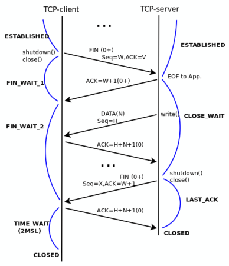
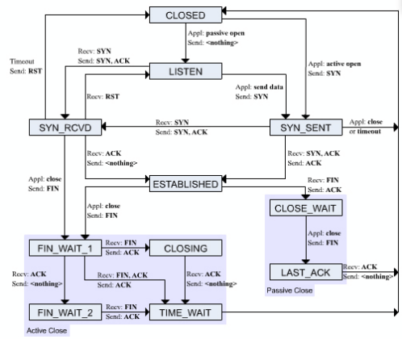

# TCP (Transmission Control Protocol)
TCP es un protocolo de comunicación confiable y orientado a conexión que se utiliza en la capa de transporte del modelo OSI. Proporciona una comunicación segura y garantiza la entrega de datos entre aplicaciones en diferentes dispositivos de una red.

## Características principales
- **Orientado a conexión**: TCP establece una conexión entre el emisor y el receptor antes de enviar datos, lo que permite una comunicación confiable y ordenada.

- **Garantía de entrega**: TCP garantiza que los datos enviados lleguen a su destino sin pérdida ni duplicación. Si se detecta algún error, TCP retransmite los datos.

- **Control de flujo**: TCP utiliza un mecanismo de control de flujo para evitar que el emisor envíe datos más rápido de lo que el receptor puede procesar, asegurando una comunicación eficiente.

- **Control de congestión**: TCP implementa algoritmos de control de congestión para evitar la saturación de la red y mejorar el rendimiento general de la comunicación.

- **Segmentación de datos**: TCP divide los datos en segmentos más pequeños antes de enviarlos, lo que facilita la transmisión y permite la reensamblación de los datos en el receptor.

## Encabezado TCP
El encabezado de TCP tiene un tamaño mínimo de 20 bytes y contiene información crucial para la comunicación, incluyendo:
- **Puerto de origen**: Identifica el puerto del remitente.
- **Puerto de destino**: Identifica el puerto del destinatario.
- **Número de secuencia**: Indica el orden de los segmentos enviados, lo que permite al receptor reensamblar los datos correctamente.
- **Número de acuse de recibo (ACK)**: Indica el número de secuencia del siguiente segmento que el receptor espera recibir, confirmando la recepción de los datos anteriores.
- **Longitud del encabezado**: Indica el tamaño del encabezado TCP.
- **Banderas de control**: Incluyen indicadores como SYN, ACK, FIN, RST, PSH y URG, que controlan el establecimiento, la terminación y la gestión de la conexión.
- **Ventana de recepción**: Indica la cantidad de datos que el receptor está dispuesto a aceptar, lo que permite el control de flujo.
- **Checksum**: Se utiliza para verificar la integridad de los datos y detectar errores durante la transmisión.
- **Puntero urgente**: Indica la posición de los datos urgentes en el flujo de datos, si los hay.

## Establecimiento de conexión (Three-way handshake)
El establecimiento de una conexión TCP se realiza mediante un proceso llamado "three-way handshake", que consta de tres pasos:
1. **SYN**: El cliente envía un segmento SYN (synchronize) al servidor para iniciar la conexión.
2. **SYN-ACK**: El servidor responde con un segmento SYN-ACK (synchronize-acknowledge) para confirmar la recepción del segmento del cliente.
3. **ACK**: El cliente envía un segmento ACK (acknowledge) al servidor para confirmar la recepción del segmento del servidor y completar el establecimiento de la conexión.

## Terminación de conexión (Four-way handshake)
La terminación de una conexión TCP se realiza mediante un proceso llamado "four-way handshake", que consta de cuatro pasos:
1. **FIN**: El cliente envía un segmento FIN (finish) al servidor para indicar que desea finalizar la conexión.
2. **ACK**: El servidor responde con un segmento ACK para confirmar la recepción del segmento FIN del cliente.
3. **FIN**: El servidor envía un segmento FIN al cliente para indicar que también desea finalizar la conexión.
4. **ACK**: El cliente responde con un segmento ACK para confirmar la recepción del segmento FIN del servidor y completar la terminación de la conexión.

### TCP Close
El proceso de cierre de una conexión TCP puede ser iniciado por cualquiera de las partes (cliente o servidor) y sigue el procedimiento del four-way handshake. Una vez que ambos lados han enviado y recibido los segmentos FIN y ACK correspondientes, la conexión se considera cerrada y los recursos asociados a la conexión se liberan.

## Conceptos importantes
- Sólo se va a incrementar en SEQ cuando se envíen datos, no cuando se envíen ACKs o segmentos sin datos.
- El número de secuencia (SEQ) es un número de 32 bits que se utiliza para identificar el orden de los segmentos enviados. Cada segmento enviado incrementa el número de secuencia en función del tamaño de los datos enviados. Se inicia con un número de secuencia inicial (ISN) que se negocia durante el establecimiento de la conexión. Después es la suma del número de bytes enviados, por lo que si se envían 100 bytes, el siguiente segmento tendrá un SEQ incrementado en 100. 

## TCP Diagrama de Estados (Finite State Machine)
El protocolo TCP se puede representar mediante una máquina de estados finita (FSM) que describe los diferentes estados de la conexión y las transiciones entre ellos. Los estados principales incluyen:
- **CLOSED**: Estado inicial, donde no hay conexión establecida.
- **LISTEN**: Estado en el que el servidor está esperando una solicitud de conexión entrante.
- **SYN_SENT**: Estado en el que el cliente ha enviado un segmento SYN y está esperando un segmento SYN-ACK del servidor.
- **SYN_RECEIVED**: Estado en el que el servidor ha recibido un segmento SYN y ha enviado un segmento SYN-ACK al cliente.
- **ESTABLISHED**: Estado en el que la conexión está establecida y los datos pueden ser enviados y recibidos.
- **FIN_WAIT_1**: Estado en el que el cliente ha enviado un segmento FIN y está esperando un segmento ACK del servidor.
- **FIN_WAIT_2**: Estado en el que el cliente ha recibido un segmento ACK del servidor y está esperando un segmento FIN del servidor.
- **CLOSING**: Estado en el que ambos lados han enviado segmentos FIN y están esperando los correspondientes ACKs.
- **TIME_WAIT**: Estado en el que el cliente ha recibido un segmento FIN del servidor y está esperando un tiempo determinado antes de cerrar la conexión
- **CLOSE_WAIT**: Estado en el que el servidor ha recibido un segmento FIN del cliente y está esperando que la aplicación cierre la conexión.
- **LAST_ACK**: Estado en el que el servidor ha enviado un segmento FIN al cliente y está esperando un segmento ACK del cliente para cerrar la conexión.

## Relación entre SEQ y ACK
En TCP, los números de secuencia (SEQ) y los números de acuse de recibo (ACK) están estrechamente relacionados. El número de secuencia indica el orden de los segmentos enviados, mientras que el número de acuse de recibo indica el siguiente número de secuencia que el receptor espera recibir. Esta relación permite al receptor reensamblar los datos correctamente y garantiza la entrega confiable de los datos. Por ejemplo, si el emisor envía un segmento con un número de secuencia de 100 y el receptor recibe correctamente ese segmento, enviará un acuse de recibo con un número de secuencia de 101, indicando que espera recibir el siguiente segmento con ese número de secuencia. Y viceversa, si el receptor recibe un segmento con un número de secuencia de 101, enviará un acuse de recibo con un número de secuencia de 102, indicando que espera recibir el siguiente segmento con ese número de secuencia. Esta relación entre SEQ y ACK permite a TCP garantizar la entrega confiable de los datos y mantener el orden correcto de los segmentos durante la transmisión.

## Stop and Wait (SW)
El protocolo Stop and Wait es un método simple de control de flujo y retransmisión utilizado en TCP. En este método, el emisor envía un segmento y espera un acuse de recibo (ACK) del receptor antes de enviar el siguiente segmento. Si no se recibe un ACK dentro de un tiempo determinado, el emisor retransmite el segmento. Este método garantiza la entrega confiable de datos, pero puede ser ineficiente en redes con alta latencia, ya que el emisor debe esperar a que el receptor confirme la recepción de cada segmento antes de enviar el siguiente.

## Control de errores
### Go Back-N (GBN) y Selective Repeat (SR)
TCP utiliza mecanismos de control de flujo y retransmisión para garantizar la entrega confiable de datos. Dos de los algoritmos más comunes son Go Back-N (GBN) y Selective Repeat (SR):

- **Go Back-N (GBN)**: En este algoritmo, el emisor puede enviar múltiples segmentos sin esperar un acuse de recibo, pero si se detecta un error en un segmento, el emisor retransmite ese segmento y todos los segmentos posteriores, incluso si algunos de ellos fueron recibidos correctamente. La ventana de envío se utiliza para controlar la cantidad de segmentos que el emisor puede enviar antes de recibir un acuse de recibo, a esta se le asigna un tamaño por cada conexión el cual puede ir variando en el transcurso de la conexión (Es dinámica). Este método es más eficiente que Stop and Wait, pero puede resultar en la retransmisión innecesaria de segmentos que ya fueron recibidos correctamente.

- **Selective Repeat (SR)**: En este algoritmo, el emisor puede enviar múltiples segmentos sin esperar un acuse de recibo, y si se detecta un error en un segmento, solo se retransmite ese segmento específico, no todos los segmentos posteriores. Se debe de indicar al establecer la conexión el uso de SR (por si ambos admiten el algoritmo), por defecto siempre se utiliza GBN, y luego en cada segmento se indica si se utiliza GBN o SR indicando en la parte opcional del encabezado qué segmentos se deben retransmitir. Esto mejora la eficiencia de la comunicación, ya que solo se retransmiten los segmentos que realmente se perdieron o llegaron con errores. 

### Detección de errores
TCP utiliza un mecanismo de detección de errores basado en el uso de sumas de verificación (checksums) para garantizar la integridad de los datos transmitidos. Cada segmento TCP incluye un campo de checksum en su encabezado, que se calcula a partir de los datos del segmento y algunos campos del encabezado. Cuando el receptor recibe un segmento, calcula el checksum nuevamente y lo compara con el valor recibido. Si los valores coinciden, se considera que el segmento se recibió correctamente; de lo contrario, se descarta el segmento y se solicita su retransmisión.

#### NAK (Negative Acknowledgment)
Es un concepto dentro del protocolo que no existe implícitamente como flag, pero se reconocen cuando se detectan 4 ACKs duplicados, lo que indica que un segmento se ha perdido o llegó con errores. En este caso, el emisor retransmite el segmento correspondiente sin esperar a que se agote el tiempo de espera (RTO). Esto permite una recuperación más rápida de los errores y mejora la eficiencia de la comunicación. 

#### Cálculo de RTO (Retransmission Timeout)
El tiempo de espera para la retransmisión (RTO) es un parámetro crítico en TCP que determina cuánto tiempo debe esperar el emisor antes de retransmitir un segmento si no recibe un acuse de recibo (ACK) del receptor. El RTO se calcula utilizando el tiempo de ida y vuelta (RTT) estimado y su variación, lo que permite adaptarse a las condiciones cambiantes de la red. El cálculo del RTO se realiza mediante el siguiente algoritmo:
1. Se mide el tiempo de ida y vuelta (RTT) para cada segmento enviado y recibido correctamente.
2. Se calcula un promedio ponderado del RTT utilizando una constante de suavizado (α) para dar más peso a las mediciones recientes.
3. Se calcula la desviación del RTT (RTTvar) para tener en cuenta la variabilidad en los tiempos de respuesta.
4. Se calcula el RTO utilizando la siguiente fórmula:

$$
RTO = RTT + 4 \times RTTvar
$$

Las nuevas muestras tienen un peso de 1/8, mientras que las muestras anteriores tienen un peso de 7/8. Esto permite que el RTO se ajuste dinámicamente a las condiciones de la red y minimice la probabilidad de retransmisiones innecesarias.

## Datos opcionales en el encabezado TCP
El encabezado TCP puede incluir campos opcionales que proporcionan información adicional para mejorar la comunicación. Algunos de los campos opcionales más comunes son:
- **Timestamp**: Permite medir el tiempo de ida y vuelta (RTT) de los segmentos y mejorar el cálculo del RTO. Un ejemplo sería: 
  - Timestamp Value (TSval): Indica el tiempo en que se envió el segmento.
  - Timestamp Echo Reply (TSecr): Indica el tiempo en que se recibió el segmento, permitiendo al emisor calcular el RTT.

- **SACK (Selective Acknowledgment)**: Utilizado por Selective Repeat. Permite al receptor informar al emisor sobre los segmentos que se han recibido correctamente, incluso si algunos segmentos intermedios se han perdido. Esto mejora la eficiencia de la retransmisión, ya que el emisor solo necesita retransmitir los segmentos perdidos en lugar de todos los segmentos posteriores.

- **Window Scale**: Permite ampliar el tamaño de la ventana de recepción más allá del límite de 16 bits, lo que es útil en redes de alta velocidad y baja latencia. Esto permite un mayor control de flujo y mejora el rendimiento de la comunicación. Se utilizan potencias de 2 para escalar el tamaño de la ventana, lo que permite un rango de valores más amplio y una mayor eficiencia en la transmisión de datos.

- **MSS (Maximum Segment Size)**: Indica el tamaño máximo de segmento que el emisor está dispuesto a recibir, lo que ayuda a evitar la fragmentación de los datos y mejora la eficiencia de la transmisión.

## Pipelining
El pipelining es una técnica utilizada en TCP para mejorar la eficiencia de la transmisión de datos. Permite al emisor enviar múltiples segmentos sin esperar a que se reciban los acuses de recibo (ACK) de cada uno. Esto reduce el tiempo de espera y aumenta el rendimiento de la comunicación, especialmente en redes con alta latencia. Se utiliza el encabezado de ventana de recepción para controlar la cantidad de datos que el receptor puede aceptar, evitando la saturación de la red y asegurando una comunicación eficiente. 
- Para calcular el tamaño óptimo de la ventana se aplica esta fórmula: 

$$
\text{Tamaño de la ventana} = \text{Ancho de banda} \times \text{Retardo de ida y vuelta (RTT)}
$$

